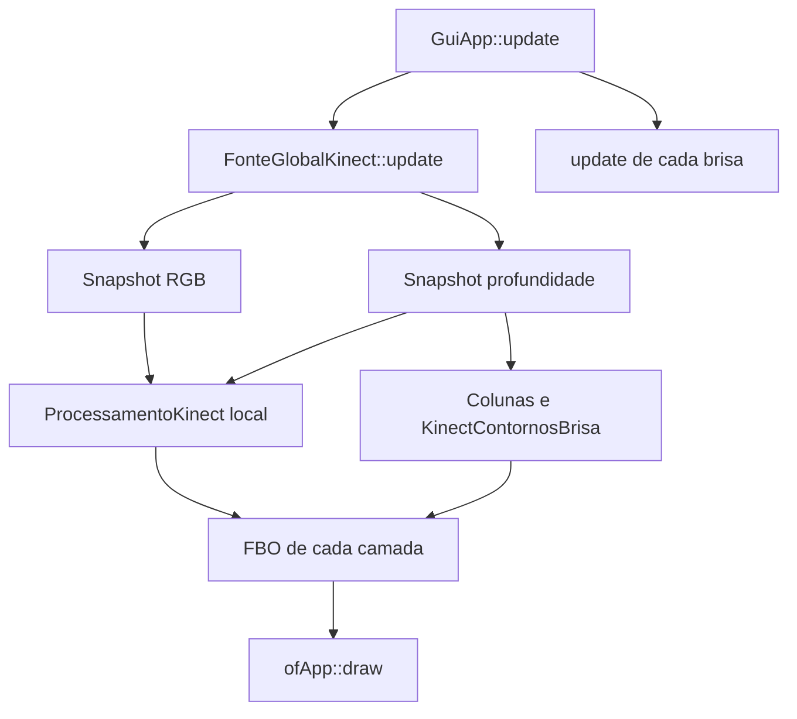

# Como as brisas e o Kinect se organizam

A ideia é esta: a fonte cuida da câmera, cada brisa cuida do seu efeito e uma coleção cuida de criar e liberar as camadas. Assim, dá para mudar uma parte sem espalhar responsabilidades pelo programa todo.

Quando este guia fala em **dono**, é o objeto responsável por manter um recurso vivo e liberá-lo depois. Um `unique_ptr` faz essa liberação automaticamente. Já um **frame** é uma imagem de um instante do vídeo, e um **FBO** é uma área de desenho na placa de vídeo: a camada desenha ali antes de aparecer na projeção.

## Quem cuida de quê

| Recurso | Dono | Quando é liberado |
| --- | --- | --- |
| Camadas (`Brisa`) | `GuiApp::camadas`, uma `ColecaoBrisas` com `unique_ptr` | Ao excluir a camada ou limpar a coleção |
| FBOs, imagens e filtros de uma camada | A própria camada, por membros de valor | Com a destruição da camada |
| Aparelho Kinect | `FonteGlobalKinect`, por `unique_ptr` privado | Ao desligar ou encerrar |
| Frames RGB e profundidade | `FonteGlobalKinect` | Na troca de origem ou no encerramento |
| Vídeos de demonstração | `FonteGlobalKinect` | No encerramento |
| Interface ImGui | `GuiApp`, por `unique_ptr` | Em `GuiApp::exit`, com contexto OpenGL ativo |

Não há `new`, `delete` ou `release()` manual para transferir camadas. Para adicionar:

```cpp
registraBrisa(std::make_unique<KinectCamBrisa>());
```

A coleção não pode ser copiada nem movida. Assim, sua referência dentro das brisas permanece válida. `busca(id)` retorna um ponteiro emprestado para uso imediato; não o guarde entre frames e não o destrua.

## Fluxo de um frame



A fonte é atualizada uma vez por `GuiApp::update`, antes das camadas. Uma brisa nunca chama `update`, `open` ou `close` do aparelho. Os getters da fonte retornam referências constantes; elas devem ser usadas até a próxima atualização, sem guardar referências aos buffers internos entre frames.

A aplicação usa as duas janelas na thread principal. O singleton não oferece sincronização para consumidores em outras threads.

## Captura compartilhada, filtros individuais

Os arquivos `FonteGlobalKinect.h/.cpp` e `ProcessamentoKinect.h/.cpp` ficam em `src/Brisas/kinect/`, junto das camadas que usam o aparelho.

`FonteGlobalKinect` é um serviço independente: não herda de `Brisa`. Seu construtor é privado, e cópia/atribuição são proibidas. `getInstance()` fornece a única instância.

`ProcessamentoKinect` substitui a antiga `FonteKinect`. É um membro por valor de `SombraBrisa`, `MatrizBrisa` e `KinectCamBrisa`. Mantém a seleção de canal, espelhos, blur, erosão, dilatação, brilho, contraste e rastro. Esses filtros operam em cópias locais. Alterar o filtro de uma sombra não modifica os pixels consumidos por outra brisa.

`Colunas` e `KinectContornosBrisa` leem profundidade diretamente da fonte global e mantêm seus próprios efeitos. Todas as camadas tratam frames ausentes antes de acessar pixels ou chamar OpenCV. `Colunas` aloca seus buffers após o primeiro frame, sem esperar pelo aparelho no construtor.

Os botões de ligar/desligar solicitam uma operação, executada na atualização seguinte. Ângulo e corte de profundidade também são aplicados no `update`, apenas quando mudam. Uma tentativa de conexão que falhar não entra em repetição automática.

Sem câmera, os vídeos opcionais `bin/data/kinectdemo/depthdance.mp4` e `rgbdance.mp4` fornecem a demonstração para todas as camadas. Cada vídeo é carregado uma única vez. Se estiver ausente ou não carregar, o canal fica sem frame e suas camadas limpam a saída. A troca câmera/demonstração limpa os snapshots anteriores.

## Exclusão, foco e shaders

Cada camada recebe um ID crescente, independente da posição no vetor. O foco e a seleção de fonte dos shaders usam esse ID. Reordenar camadas preserva essas escolhas; excluir a fonte de um shader limpa sua seleção. Os IDs não são reutilizados após `clear()`.

`Brisa::desenhaJanela` retorna uma ação. `GuiApp` aplica a ação depois de terminar e renderizar o ImGui, evitando destruir uma camada durante seu próprio método ou enquanto suas texturas ainda fazem parte da interface pendente. A projeção consulta a coleção atual.

Sem fonte externa selecionada, o shader recebe a textura da própria camada. Isso evita manter uma textura anteriormente selecionada e já excluída.

## Encerramento

`GuiApp::exit` ativa o contexto da janela da interface, limpa a coleção, encerra a fonte e destrói o ImGui. É seguro chamá-lo novamente. O singleton fica encerrado e não reabre recursos em chamadas posteriores de `update`.

Essa ordem é necessária porque os destrutores de FBOs e texturas precisam executar antes de destruir o contexto OpenGL. `unique_ptr` resolve a propriedade; a ordem de encerramento continua explícita.

As listas antigas de timelines foram removidas: estavam vazias e sem fluxo de criação. Uma futura timeline deve guardar IDs de camadas ou possuir sua própria coleção, com regras explícitas de duração.

## Validação

A partir da raiz do projeto:

```sh
make -j2
make -f tests/Makefile TestReleaseABI -j2
obj/linux64/Release/tests/lifecycle
obj/linux64/Release/tests/lifecycle --gl
```

O teste sem `--gl` verifica destruição única, IDs, exclusões repetidas e referências preservadas após reordenação. O teste gráfico precisa de uma sessão OpenGL válida; verifica filtros com pixels sintéticos, troca de dimensões/canais, entrada imutável, ausência de frames, ciclos de criação/exclusão e encerramento.

Para exercitar também a captura de demonstração compartilhada, passe após `--gl` um diretório de dados com `kinectdemo/depthdance.mp4` e `kinectdemo/rgbdance.mp4`. Os testes não abrem o aparelho. Conexão USB, ângulo físico e desconexão real ainda precisam de um Kinect.
